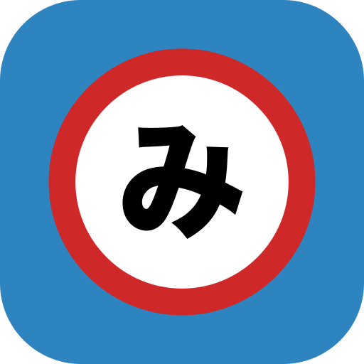

<div align="center">



# TachiyoMihon

### Mihon, with the Tachiyomi v14 reading habits back
A personal fork of [Mihon](https://github.com/mihonapp/mihon) that follows its stable releases and reverts a handful of changes that affected my Tachiyomi reading habits.

[](https://github.com/MD-1909/TachiyoMihon/releases/latest)
[](https://github.com/MD-1909/TachiyoMihon/actions/workflows/tachiyomihon-sync.yml)
[](https://github.com/mihonapp/mihon/releases/latest)
[](/LICENSE)

## Download

Grab the latest APK from [Releases](https://github.com/MD-1909/TachiyoMihon/releases/latest). Most modern phones want the `arm64-v8a` build; the plain `tachiyomihon-v*.apk` is universal.

It installs as a separate app (`app.mihon.tachiyomihon`), so it can live next to Mihon. After the first install, updates are offered and installed from inside the app.

*Requires Android 8.0 or higher.*

## What's different from Mihon

<div align="left">

| Area | Mihon | TachiyoMihon |
| --- | --- | --- |
| **Downloaded only – reader** | The reader only knows about downloaded chapters. Moving past the first/last downloaded chapter shows *"There's no previous chapter"*. | Library and chapter list stay filtered to downloads, but the reader moves into the neighbouring non-downloaded chapter and streams it, like Tachiyomi v14. |
| **Downloaded only – browsing** | Applies to every manga, so titles you browse that aren't in your library show 0 chapters. | Only narrows manga that are in your library. |
| **Downloaded only – download menu** | *Next 1/5/10/25 unread*, *Unread* and *Bookmarked* only look at downloaded chapters, so they do nothing. | They pick from the chapters hidden by downloaded-only mode, so you can still queue the next chapters. |
| **Reading mode & rotation** | Bottom-bar buttons open a sheet with an icon grid and an extra *Apply* button. | A plain list sitting right above the button, like Tachiyomi: tap an option and it's applied. Bar order is reading mode, crop, rotation, settings. |
| **Page slider haptics** | Faint "text handle" tick, only while dragging. | Tachiyomi's firmer tick, on drags and taps. |
| **Unread indicator** | A dot next to every unread chapter (chapter list and Updates). | Removed. Unread chapters are still shown in full brightness, read ones dimmed. |
| **Missing chapters** | Warning in the chapter header, "missing chapters" rows between chapters, a warning in the reader and a forced transition page at every numbering gap, even when the gap only exists because of a filter. | Reader warning and forced transition pages removed. Header warning and gap rows are hidden by default (toggle in *Settings → Library*). |
| **Removing from library** | *"Are you sure?"* every time. | Instant from your library, updates and history. Still asks while browsing a source. |
| **Library selection bar** | *Migrate* takes a slot, pushing *Delete* into the overflow menu. | *Migrate* removed, *Delete* is a visible icon again (still asks whether to delete downloads). |
| **Global search** | Starts with pinned sources only, with *Pinned* / *All* buttons to switch. | Setting in *Settings → Browse*: always all sources (default), always pinned only, or keep the buttons. *Has results* is unchanged. |
| **Source toolbar** | *Open in WebView* and extension *Settings* hidden behind a ⋮ menu. | Always-visible globe icon for WebView, like Tachiyomi. Extension settings stay in *Browse → Extensions*. |
| **Source filters** | Oversized outlined boxes with small text inside. | Tachiyomi-style rows: *Status: All ▾* dropdowns and underlined text fields, no boxes. |
| **Sliders** | Material 3 Expressive: tall track, bar-shaped thumb, track split around the thumb. | The older look everywhere (reader page slider and settings): thin track with dot ticks and a round thumb. |
| **Icon** | Mihon's blue ring. | Tachiyomi's blue and red with Mihon's kanji. |
| **Updates** | From `mihonapp/mihon`. | From this repo's releases (the About screen's GitHub link points here too). Versions are `<Mihon version>.<revision>`, e.g. `v0.21.3.2`. |
| **Telemetry** | Firebase crash reporting in GitHub builds. | Not included. |

Unchanged on purpose: *Resume* still jumps to the next **downloaded** unread chapter, and *Settings → Reader → Skip filtered chapters* works as in Mihon.

### How it stays up to date

1. A daily workflow checks for a new stable Mihon release and merges it into the `tachiyomihon` branch.
2. A guard script ([`tachiyomihon-guard.sh`](.github/scripts/tachiyomihon-guard.sh)) fails if the merge brings back any of the reverted behaviour, then unit tests and a release build run.
3. If everything passes, a pull request opens with Mihon's release notes and a list of upstream changes to files this fork customizes. If anything fails, an issue is opened instead.
4. Merging that pull request builds, signs and publishes a release, and the app offers the update. The same happens for any other merged pull request, except ones that only touch docs or images.

### Building locally

```sh
./gradlew assembleRelease
```

Requires JDK 21. Add `-Penable-updater` to turn on the in-app updater. To sign with your own key, create a git-ignored `keystore.properties` in the project root with `storeFile`, `storePassword`, `keyAlias` and `keyPassword`.

To try changes on a phone that already has the release installed, build with `-PtachiyomihonPreview`. It installs as a separate **TachiyoMihon Preview** app (`app.mihon.tachiyomihon.preview`).

Issues specific to this fork go [here](https://github.com/MD-1909/TachiyoMihon/issues). Anything that also happens in Mihon belongs [upstream](https://github.com/mihonapp/mihon/issues).

</div>

---

Based on [Mihon](https://github.com/mihonapp/mihon), all credit for the app goes to its contributors. Licensed under [Apache 2.0](/LICENSE), like Mihon. This app hosts no content and has no affiliation with any content provider.

</div>
